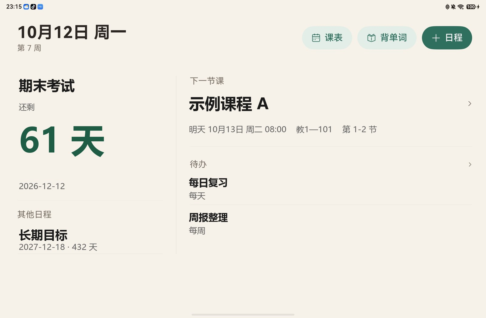
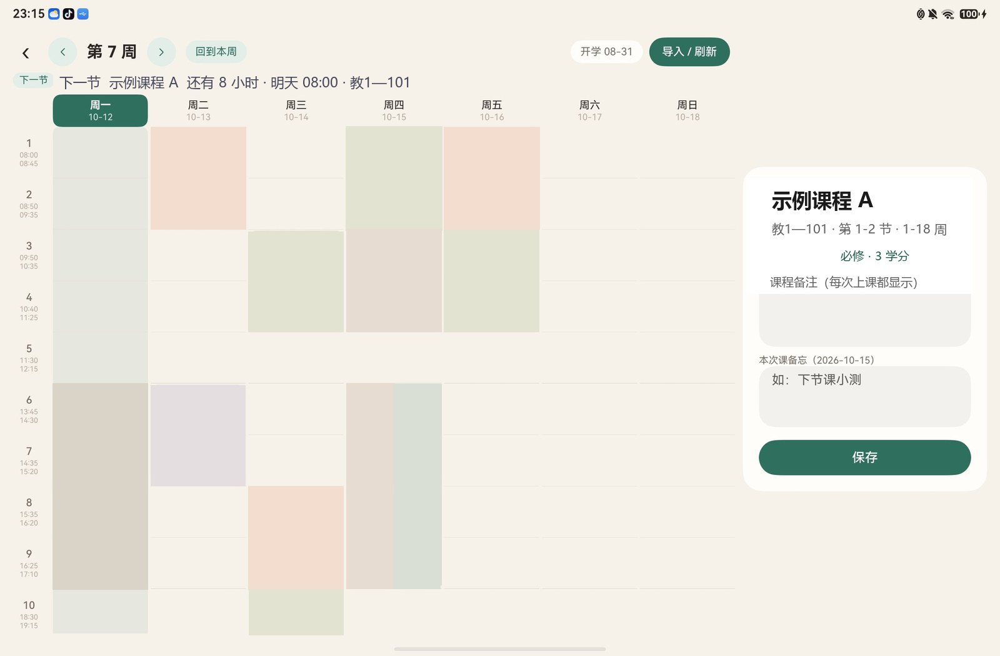

# ClassCount

鸿蒙（HarmonyOS NEXT）课表应用：课表 + 日程手账 + 桌面服务卡片。



## 功能

### 课表

- 在应用内用 ArkWeb 打开学校教务系统登录页，走统一身份认证登录后抓取课表 JSON 并解析；**账号密码不经过本应用**
- 周视图课表：左右切换周次、显示开学日期、课程按节次与周次排布
- 课程备注、单次课备忘
- 空态引导，没有数据时提示导入路径



### 日程手账

- 倒计时日程：剩余天数、周进度、总进度
- 待办：1–5 星优先级、按星期或固定间隔重复、完成后顺延、历史记录
- 按日写日记

### 桌面服务卡片

- 主应用把日程快照推送给卡片进程，卡片独立渲染（不依赖主应用存活）
- 卡片显示最近日程的标题、剩余天数与进度环，点击跳回应用

## 附带功能

- **背单词**：导入词表、按轮次刷词、掌握度统计、错词本。根目录的 `wordbook/wordbook.json` 是示例词库，仅供演示与离线测试使用

## 技术栈

| 项 | 说明 |
| --- | --- |
| 平台 | HarmonyOS NEXT（Stage 模型） |
| 语言 / 框架 | ArkTS / ArkUI |
| 编译目标 | API 23（6.1.0） |
| 构建 | DevEco Studio + hvigor |
| 第三方依赖 | 无，全部使用系统 Kit |

## 项目结构

```
entry/src/main/ets/
├── model/                  数据层
│   ├── Course.ets          课表模型 + 教务 JSON 解析 + 「下一节课」算法
│   ├── CourseStore.ets     课表持久化 + 内置数据导入 + 备注
│   ├── Schedule.ets        日程模型 + 卡片快照 + 进度算法
│   ├── ScheduleStore.ets   日程持久化
│   ├── CardData.ets        卡片数据契约（单一真源）
│   ├── CardPusher.ets      主应用 → 卡片推送
│   ├── Wordbook.ets        词表解析、轮次与统计
│   └── WordbookStore.ets   词表持久化
├── features/planner/       日程手账的重复规则与存储
├── entryformability/       卡片生命周期
├── entryability/           主应用入口
├── common/                 视觉令牌与窗口配色
├── pages/                  首页 / 课表 / 导入 / 手账 / 背单词
└── widget/pages/           桌面服务卡片（自包含）
```

## 构建与运行

1. 用 DevEco Studio 打开本仓库根目录
2. 配置签名：`File → Project Structure → Signing Configs`，勾选 Automatically generate signature（需登录华为账号），或填入自己的证书与 Profile。**本仓库不包含任何签名材料**
3. 连接 HarmonyOS 设备或启动模拟器，运行 `entry` 模块

> 构建直接用 DevEco Studio（Build → Build Hap(s) / APP(s)）。仓库未包含命令行 hvigor 启动脚本：原始工程里的 `hvigorw` / `hvigorw.bat` 调用了一个不存在的入口文件，已在整理时移除，避免留下跑不通的脚本。

## 离线测试

纯逻辑层不需要设备和 IDE 就能验证。测试通过 Node 的类型擦除直接加载工程里的 `.ets` 源码，不复制逻辑副本：

```bash
node test/course.mjs         # 课表解析、周次与「下一节课」算法  40 项
node test/run.mjs            # 日程天数与进度算法                34 项
node test/planner.mjs        # 重复规则与顺延场景                20 组
node test/planner-store.mjs  # 存储层故障注入                     7 组
node test/wordbook.mjs       # 词表解析与轮次统计                24 项
```

合计 125 项，全部通过。

## 适配其他学校

**必须先做这一步**：仓库里的教务系统地址是占位符（`example.edu.cn`），不替换就用不了抓取功能。

- `entry/src/main/ets/common/Campus.ets`：统一身份认证登录页、信息门户、教务系统首页与课表接口路径，**全部集中在这一个文件**
- `entry/src/main/ets/model/Course.ets`：课表接口的请求方式与返回字段映射（`parseKbJson`）

不同厂商的教务系统返回结构不同，按自己的 JSON 结构调整 `parseKbJson` 即可。周次解析与「下一节课」算法与学校无关；但第 1–12 节的起止时间各校不同，写在 `entry/src/main/ets/model/Course.ets` 的作息表里，需要按自己学校的作息时间调整。

## 说明

- `entry/src/main/resources/rawfile/kebiao_init.json` 是**虚构的示例课表**，仅用于演示内置导入与离线调试
- `wordbook/wordbook.json` 是**自编的示例词表**（24 个常见词，释义自行编写），仅用于演示导入与离线测试
- 截图用于展示界面，其中的课程、日程与词表条目均为示例内容，与仓库内置的示例数据不完全一致
- 应用图标（`AppScope/resources/base/media/app_icon.png`、`entry/src/main/resources/base/media/` 下的前景与启动图）为 AI 辅助生成并经后期处理，未使用任何第三方角色或品牌素材
- 架构说明见 [docs/ARCHITECTURE.md](docs/ARCHITECTURE.md)

## License

[MIT](LICENSE)
